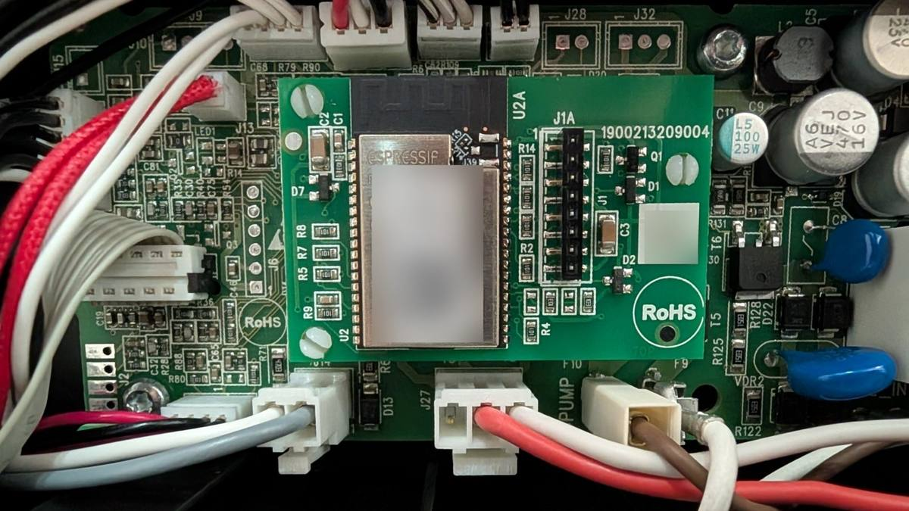
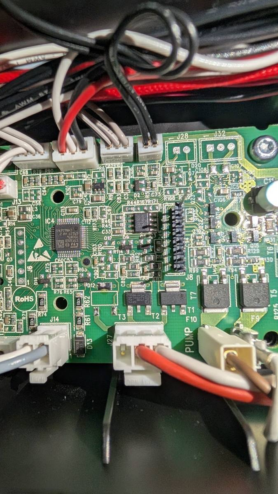
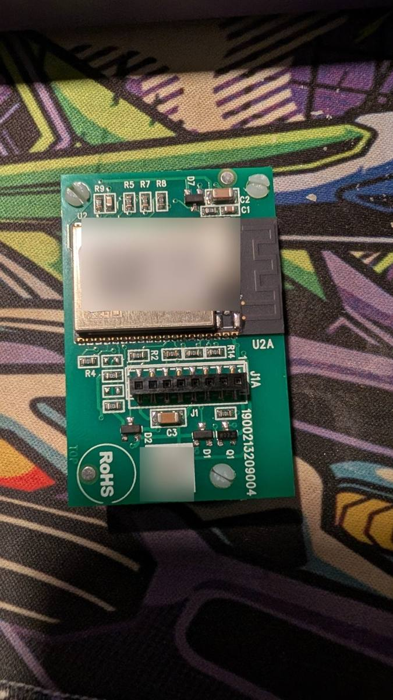
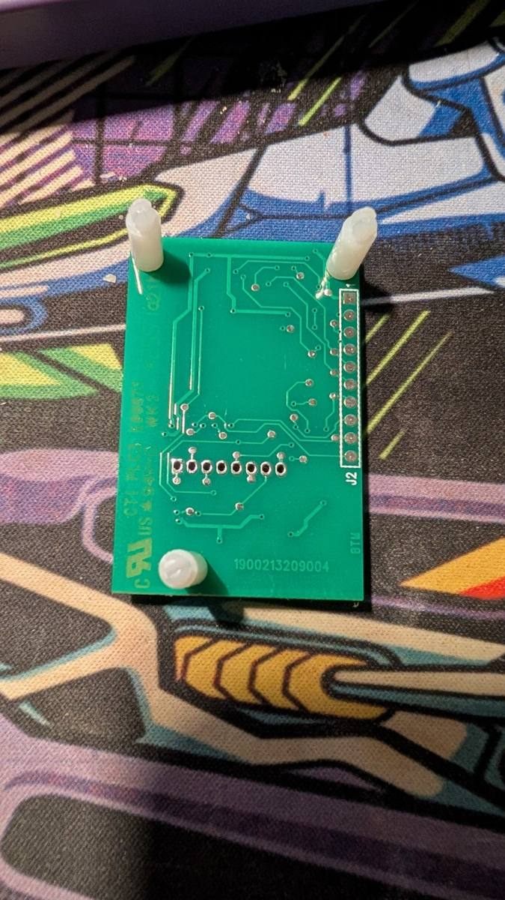
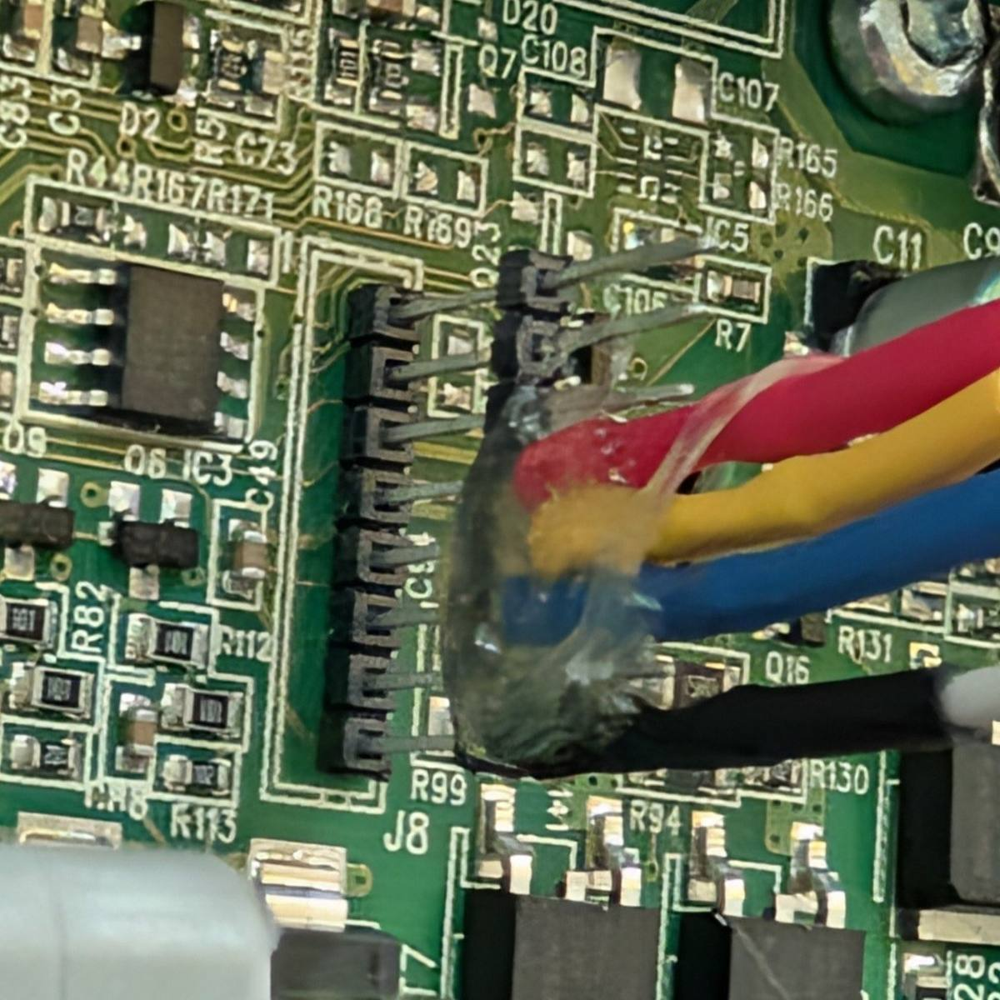
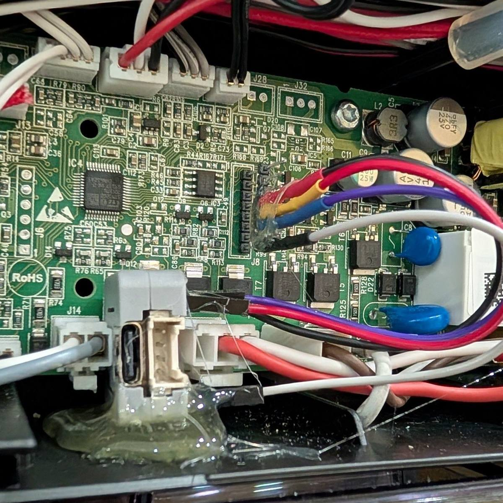

# Hardware notes: De'Longhi Eletta Explore (ECAM450.65.G)

## Boards

- **Mainboard:** STM32G0-based. It talks to the Wi-Fi daughterboard over a 2.0 mm 1×8 header,
  **J8** on the mainboard silkscreen.
- **Stock Wi-Fi module:** a small board with an Espressif ESP32 module (ESP32-D0WD rev1.1,
  8 MB flash, ESP-IDF v4.0). Its connector to the mainboard is **J1A**. A second row of pads,
  **J2**, is the factory programming header (J2-1 TXD0, J2-2 RXD0, J2-3 IO0).

The pin numbers below follow the stock module's J1A (pin 1 is marked on its silkscreen). The
same pins are what the module plugs into on J8.

| Pin | Signal |
|-----|--------|
| 4 | 3V3 (powered the stock module; enough for an Atom Lite) |
| 5 | mainboard **TX** → ESP RX |
| 6 | mainboard **RX** ← ESP TX |
| 8 | GND |

UART: **115200 8N1**, 3.3 V logic. Never connect a 5 V adapter.

## Why the stock module was replaced, not reflashed

A full 8 MB flash dump was taken over J2 (IO0 to GND for download mode). It is useless offline:

- flash encryption is on (`FLASH_CRYPT_CNT=1`), the key sits in read-protected eFuse BLOCK1;
- Secure Boot v1 is on (`ABS_DONE_0`), UART download encrypt/decrypt is disabled, JTAG is off;
- bootloader, partition table and app are ciphertext; NVS values are encrypted (`nvs_keys`).

The machine also has Bluetooth, but on this model it is only used for Wi-Fi provisioning; there is no
BLE control channel. That leaves the J8 UART, and the mainboard accepts commands there without any
authentication. So the stock module comes out and anything that speaks the protocol goes in.

## Replacement: M5Stack Atom Lite

| J8 / J1A | Atom Lite |
|----------|-----------|
| 4 (3V3) | 3V3 (bottom header, bypassing the 5 V regulator) |
| 8 (GND) | GND |
| 5 (machine TX) | G19 (RX) |
| 6 (machine RX) | G22 (TX) |

Any free GPIO pair works; G19/G22 are neither strapping nor input-only pins. The Grove port is 5 V
and is not used. The header pitch is 2.0 mm: 2.54 mm Dupont sockets sit loosely, so they were glued
in place with hot glue.

Only one master may be on the line: with the Atom installed, nothing else (stock module, USB-UART
adapter) may drive J8-6.
